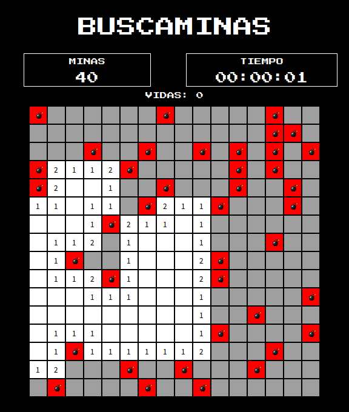

<div align="center">

# Implementación de Buscaminas en Pharo Smalltalk



</div>

# Integrantes

- Tomás Benchat
- Tiago Gabriel Domínguez
- Lautaro Leguizamón
- Santiago Portillo
- Mateo Salinas Jiménez
- Lázaro Villagra

**Grupo 36 · K2.1 · Paradigmas de Programación**  
Ingeniería en Sistemas de Información, UTN Facultad Regional Resistencia.

## 💣 Buscaminas

El escenario asignado propone limpiar un tablero de Buscaminas a partir de pistas numéricas. Al descubrir una casilla segura, su número indica cuántas de las ocho posiciones vecinas contienen minas. En los bordes y las esquinas se cuentan solo las vecinas que existen. Al abrir una casilla segura con cero minas vecinas, se descubren también las vecinas sin bandera. El jugador puede señalar con banderas las posiciones donde sospecha que hay minas y gana al descubrir todas las casillas seguras

- Con **clic izquierdo** se descubre una casilla y el reloj arranca al abrir la primera.
- Con **clic derecho** se coloca o se retira una bandera en una casilla oculta.
- Al pisar una mina se pierde una vida. Al agotar las vidas, se revelan todas las minas y se detiene el reloj.

## 🎮 Cómo ejecutarlo

1. Abrí una imagen de **Pharo 14**.
2. En **Iceberg**, cloná [este repositorio](https://github.com/tomasben/pdp-tpi) y cargá el paquete `Buscaminas`.
3. Abrí un **Playground**, y ejecuta el menú de la siguiente manera:

```smalltalk
MenuJuego abrir
```

## 🧩 Diseño orientado a objetos

- **Abstracción y clases abstractas.** `Celda` representa lo que tienen en común todas las casillas. Guarda las coordenadas, el estado de marcado y descubrimiento, y la cantidad de minas vecinas. En Pharo funciona como clase abstracta porque `tieneMina` usa `subclassResponsibility` para indicar que las subclases deben implementar ese método.
- **Herencia y redefinición.** `CeldaConMina` y `CeldaSinMina` heredan operaciones como `descubrir`, `marcar` y `desmarcar`. Cada una redefine `tieneMina` para responder `true` o `false`, respectivamente. El comportamiento compartido queda escrito una sola vez.
- **Encapsulamiento.** `Tablero` guarda la grilla internamente y valida las coordenadas en `celdaEnFila:columna:`. La interfaz usa esa consulta para obtener la celda de una posición. El ocultamiento es parcial porque la consulta devuelve una celda del modelo.
- **Cohesión y modularidad.** `Partida` coordina las jugadas y decide cuándo se gana o se pierde. `Tablero` distribuye las minas, calcula las pistas y abre las zonas en cascada. `Reloj` mide el tiempo y los objetos de Morphic se encargan de los clics y de dibujar el estado del juego.

El [informe técnico](docs/PDP-C1-BDLPSV.pdf) incluye los diagramas de clases y de secuencia.
